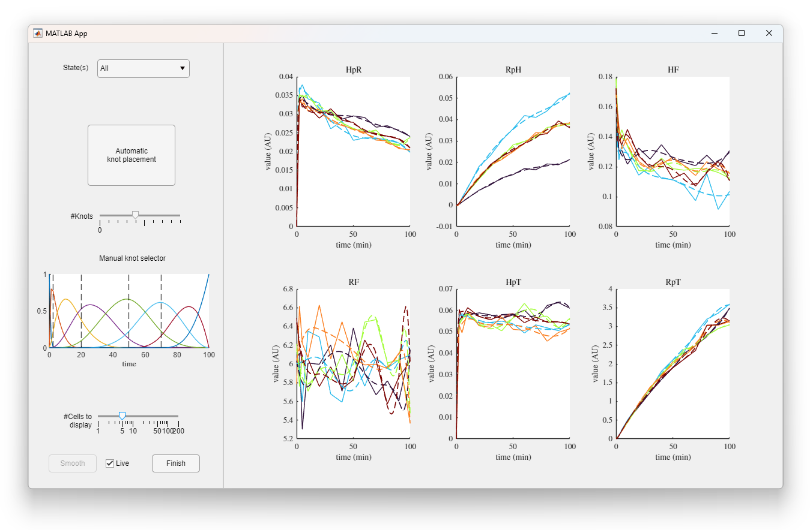
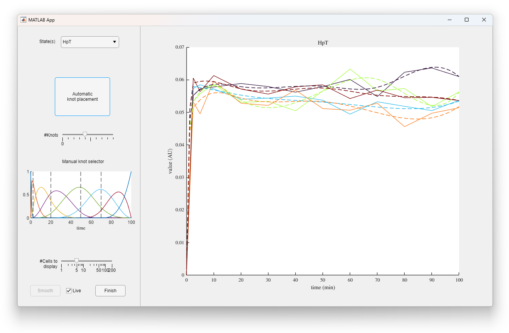
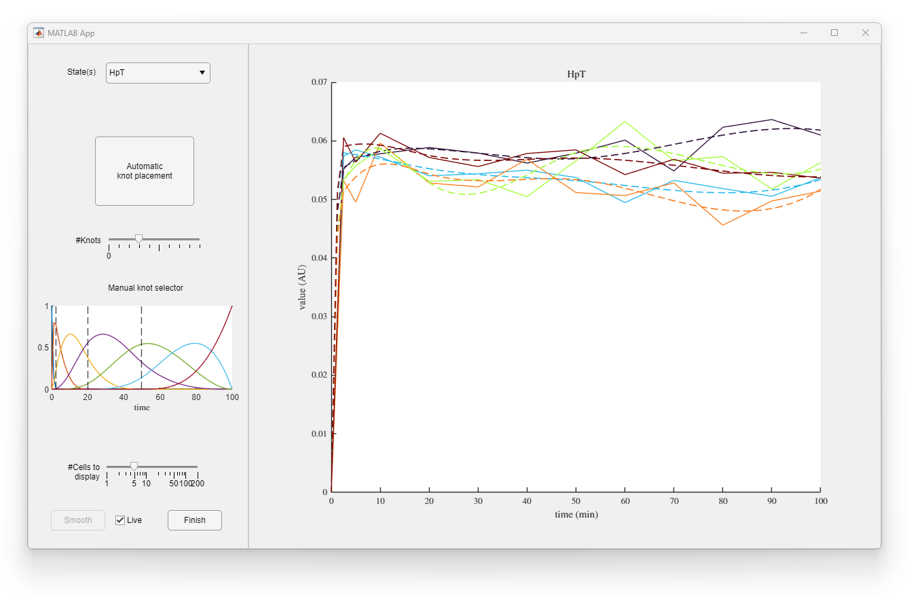
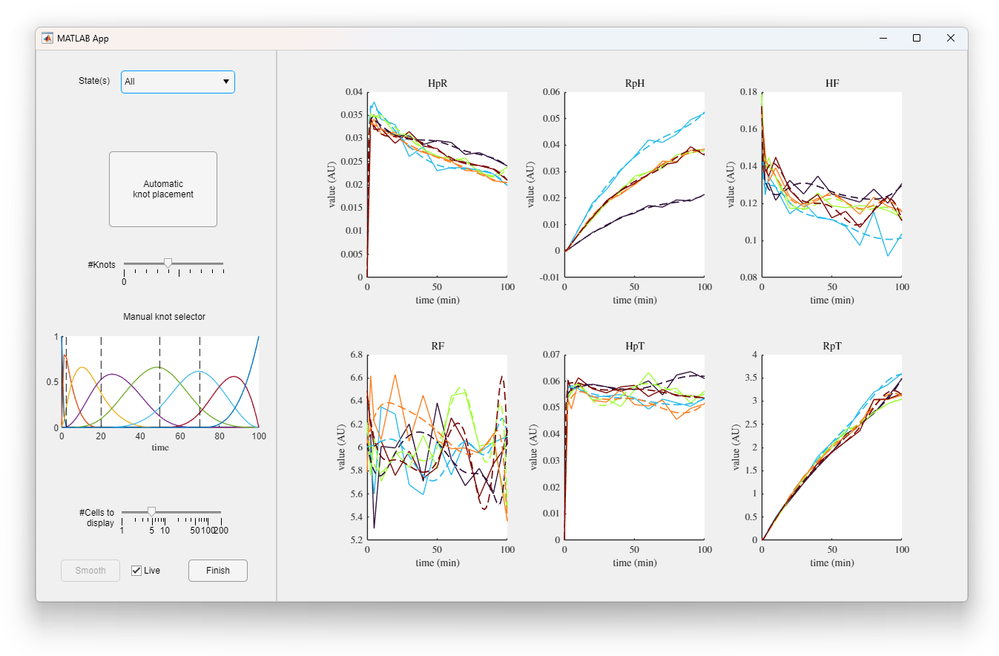

# GMGTS: Gradient Matching Global Two-Stage

[](https://doi.org/10.5281/zenodo.14884458)
[](LICENSE)

_MATLAB® code package for inference of (ODE-based) nonlinear mixed-effects (NLME) models using GMGTS, as presented in [1]._

GMGTS infers the distribution of cell-specific ODE parameters (random effects) from single-cell time series. It builds on the Global Two-Stage (GTS) framework [2], replacing the repeated numerical integration in the first stage by B-spline smoothing and gradient matching, which makes inference considerably faster. The package also contains a GTS implementation for comparison, a data generator for simulation studies, an interactive smoothing app, and all scripts and data needed to reproduce the results in [1].

**Contents**

- [Requirements](#requirements)
- [Installation](#installation)
- [Quickstart](#quickstart)
- [Repository structure](#repository-structure)
- [Reproducing the results in the paper](#reproducing-the-results-in-the-paper)
- [Usage](#usage)
- [How to cite](#how-to-cite)
- [References](#references)
- [License](#license)

&nbsp;

## Requirements

The code was developed and tested with **MATLAB R2021a** on Windows. Later MATLAB releases are expected to work; earlier releases do not support the `Name=value` syntax used throughout the scripts.

| Dependency | Used for |
| --- | --- |
| [IQM Tools](https://iqmtools.intiquan.com/) Pro, version 1.2.2 (02.01.2017) | Reading model files and compiling them to fast MEX simulation functions (`System` class) |
| A C compiler configured for MATLAB (`mex -setup C`) | Compiling the MEX models generated by IQM Tools |
| Symbolic Math Toolbox | Deriving the linear-in-parameters decomposition and Jacobians of the model right-hand side |
| Optimization Toolbox | `fmincon` (initialization, GTS, noise parameters) |
| Model Predictive Control Toolbox | `mpcActiveSetSolver` (constrained generalized least squares in the GMGTS first stage) |
| Statistics and Machine Learning Toolbox | Random effect sampling, quantiles, plotting of densities |

IQM Tools is only needed to construct `System` objects from model files. The smoothing example (`examples/example_smoothing.m`) loads a precomputed `System` object and runs without IQM Tools.

&nbsp;

## Installation

1. Clone or download this repository (or the archived release on [Zenodo](https://doi.org/10.5281/zenodo.14884458)).
2. Install IQM Tools following its own instructions, and make sure `installIQMtools` is on the MATLAB path.
3. In MATLAB, run from any folder:

   ```matlab
   run('path/to/GMGTS/setup_GMGTS.m')   % or: cd path/to/GMGTS; setup_GMGTS
   ```

   `setup_GMGTS` adds `src/`, `models/`, `data/`, `examples/`, and `experiments/utils/` to the MATLAB path and warns about missing toolboxes or IQM Tools. Use `setup_GMGTS(true)` to save the path for future sessions.

The `System` class compiles each model to a MEX file (e.g. `MEX_bifunctional.mexw64`) in the **current folder**; these files are ignored by git and can be deleted at any time.

&nbsp;

## Quickstart

```matlab
setup_GMGTS
system = System('model_generalizedLV4.txt', FixedParameters=strcat('r', string(1:16)));
generator = Generator(system, N=25, t=0:20, error_std=.1, D_mult=.25, observed=5:system.K);
rng(0); [data, ground_truth] = generator.generate();

estimator = Estimator(system, data);                % GMGTS by default
estimates = estimator.estimate();                   % struct with fields b, D, beta, ...
plot(estimator, True=ground_truth, States=9:16, MaxCells=7)
```

- `examples/example_inference.m` walks through data generation and inference (including the interactive smoothing app and the `GMGTS()` convenience function).
- `examples/example_smoothing.m` opens the interactive smoothing app on the data in `examples/example_data.mat` (IQM Tools not required).

&nbsp;

## Repository structure

```
GMGTS/
├── setup_GMGTS.m          Path setup and dependency check (run first)
├── src/                   Method implementation
│   ├── GMGTS.m            Convenience function: model file + data -> estimates
│   ├── System.m           ODE model: parsing, MEX integration, symbolic RHS decomposition
│   ├── Generator.m        Simulated single-cell data from an ODE-based NLME model
│   ├── Estimator.m        Runs GMGTS and/or GTS, collects results, plotting
│   ├── Smoother.m         B-spline smoothing (GMGTS), incl. knot placement heuristic
│   ├── FirstStage.m       GMGTS first stage (gradient matching)
│   ├── FirstStageGTS.m    GTS first stage (trajectory matching)
│   ├── SecondStage.m      Second stage (EM algorithm) shared by GMGTS and GTS
│   ├── BSpline.m          B-spline bases and derivatives
│   ├── Optimization.m     Numerical optimization routines
│   ├── smoothing_new.mlapp  Interactive smoothing app
│   └── utils/             Helper functions (distances, linear algebra, plotting)
├── models/                IQM Tools model files used in the paper
├── examples/              Example scripts and example data
├── experiments/           Scripts reproducing the results in [1]
│   └── utils/             Helpers used for post-processing (EM_lognormal, table2latex, hex2rgb)
├── data/FP_data/          Fluorescent protein maturation microscopy data (see data/README.md)
├── docs/images/           Screenshots for this README
└── results/               Created by the experiment scripts (not tracked by git)
```

&nbsp;

## Reproducing the results in the paper

Each script in `experiments/` is self-contained: run `setup_GMGTS` and then the script. Random seeds are fixed in the scripts. All outputs are written to `results/` (created automatically); the scripts save the complete MATLAB workspace, so all estimates, distances, and computation times can be inspected afterwards.

| Script | Model file(s) | Computes | Output |
| --- | --- | --- | --- |
| `inference_sim_bifunctional_accuracy.m` | `model_bifunctional.txt` | GMGTS vs. GTS accuracy (Wasserstein/Hellinger distances) and computation times for varying sampling intervals, noise levels, and full/partial observation (10 seeds each) | `results/simulation/bifunctional_accuracy.mat` |
| `inference_sim_maturation_accuracy.m` | `model_maturation_onestep.txt` | As above, for the one-step FP maturation model | `results/simulation/maturation_accuracy.mat` |
| `inference_sim_genlotka_speed_accuracy.m` | `model_generalizedLV{1,2,4,8}.txt` | Accuracy and computation times for 16-state generalized Lotka-Volterra models with 1-8 random effects | `results/simulation/genLV_speed.mat` |
| `inference_sim_repressilator.m` | `model_repressilator_full.txt` | Inference of correlated random effects in a repressilator model, with plots | `results/simulation/repressilator.mat` |
| `inference_sim_maturation_kdil_variability.m` | `model_maturation_twostep.txt` | Effect of unmodeled cell-to-cell variability in the dilution rate on maturation rate estimates (prints a LaTeX table row) | `results/simulation/variability_kdil.mat` |
| `inference_experimental.m` | `model_maturation_{twostep,onestep}.txt` | Maturation rate distributions of 12 fluorescent proteins from microscopy data, with variable and fixed maturation rate | `results/experimental/*.mat`, `results/experimental_fixed_km/*.mat` |

The simulation studies with many settings take hours to run on a desktop computer; the remaining scripts take minutes. Computation times depend on hardware, so absolute timings will differ from those reported in [1], while relative comparisons should be similar.

> **Note on numerical differences.** Version 1.1 fixes several bugs (see [CHANGELOG.md](CHANGELOG.md)). Some of these can change numerical results compared with version 1.0, which was used for [1]: the first-stage uncertainty estimates of partially observed systems; the experimental-data analysis, in which the FP-specific dilution rates previously entered only the ODE integration and not the gradient-matching step; and the reference distance `ws_truth` in the maturation accuracy study, which is now normalized like the other distances. The exact code used for [1] remains available as release [v1.0](https://github.com/yulanvanoppen/GMGTS/releases/tag/v1.0) (archived at [Zenodo](https://doi.org/10.5281/zenodo.14884458)).

&nbsp;

## Usage

### `GMGTS()` utility function

`GMGTS` attempts to recover the distribution parameters `b` and `D` of a mixed-effects model
```
    dx_i(t)/dt = g(t, x_i(t)) beta_i + h(t, x_i(t))
    beta_i ~ (log)Normal(b, D)                          (i = 1, ..., N)
```
from measurements `(t_j, y_ij)`, where `y_ij` are vectors of observed components of `x_i(t_j)` perturbed by measurement noise. The model must be linear in the (variable) parameters.

`out = GMGTS(model_file, data, ...)` infers random effect distributions of the system specified in the IQM `model_file` (see [Model files](#model-files)) from measurements given in `data`. Here `data` is either a `TxLxN`-dimensional array with measurements at `T` time points for `L` observables and `N` cells (individuals), or a `1x1 struct` with its measurements stored in a field named `y` or `traces`. The estimates are returned as a struct containing the inferred random effect mean `b` and covariance matrix `D`, individual estimates `beta`, and predicted states. Additional Name-Value arguments are passed to the `System` and `Estimator` constructors and the `Estimator.plot()` method, see below.

`out = GMGTS(model_file, data, t, ...)` specifies the measurement time points `t`. If `data` is a struct, `t` is ignored and taken from the field `data.t` instead. Default: `t = 0:size(data, 1)-1`.

`out = GMGTS(model_file, data, t, observed, ...)` specifies the indices of the observed states with respect to the system determined by `model_file`. If `data` is a struct, `observed` is taken from `data.observed` instead. Default: `observed = 1:size(data, 2)`.

`out = GMGTS(model_file, data, t, observed, init, ...)` integrates the ODE system from the initial values `init` to make state predictions. If `data` is a struct, `init` is taken from `data.init` instead. Default: `1e-4` for each state (or, for a struct without an `init` field, the initial conditions in `model_file` plus `1e-4`).

`out = GMGTS(_, Plot=false)` disables plots of the smoothed measurements, parameter estimates, model predictions, and inferred random effects distribution (enabled by default).

`[out, estimator] = GMGTS(_)` also returns the `Estimator` object.

&nbsp;

### `System` class for ODE functions and simulations

The `System` class handles ODE integration, evaluation of (functions derived from) the system's right-hand side, and the corresponding partial derivatives as part of the `Estimator` and `Generator` classes.

`system = System(model_file)` instantiates a `System` object by processing an IQM Tools `model_file`, given as a path or as a file name on the MATLAB path (e.g. `'model_bifunctional.txt'` after running `setup_GMGTS`).

`system = System(model_file, FixedParameters=names)` treats the parameters specified in `names` (string array) as constant, fixing them at their nominal values in `model_file`. All other parameters are random effects.

`system = System(model_file, FixedParameters=names, FixedValues=values)` fixes the parameters in `names` at the given `values` instead. `names` and `values` must have equal numbers of elements.

`system.set_fixed_values(names, values)` changes the values of (a subset of) the fixed parameters after construction, e.g. `system.set_fixed_values("kdil", .004)`. This rebuilds all derived functions, so that ODE integration and gradient matching use the same values. (`system.fixed` is read-only for this reason.)

#### Model files

The specified ODE system should be linear in its variable parameters, otherwise unexpected results will follow. The model file should contain the model name, the differential equations and initial conditions for each state, and nominal values for all parameters (model reactions and functions are not yet supported). The time variable is called `time`. Example:
```
********** MODEL NAME
Simple model
********** MODEL STATES
d/dt(A) = k1 - k2*A
d/dt(B) = k2*A
A(0) = 1
B(0) = 0
********** MODEL PARAMETERS
k1 = 0.1
k2 = 0.5
```
The nominal parameter values are used as defaults for data generation and to set the default parameter bounds for inference.

&nbsp;

### `Generator` class to generate data from ODE-based NLME models

`generator = Generator(system, ...)` instantiates a `Generator` object to draw parameters from a specified random effects distribution, integrate the ODE system to obtain cell trajectories, and produce measurements by perturbing the trajectories with measurement noise. `system` may also be a model file name, in which case `System` arguments such as `FixedParameters` can be included.

`measurements = generator.generate()` generates a struct containing fields `traces` (perturbed trajectories of the observed states), `t` (measurement time points), `observed` (observed state indices), `init` (initial conditions), `T` (number of time points), `L` (number of observables), and `N` (number of cells).

`measurements = generator.generate(beta)` uses the cell-specific (`P`-dimensional) parameter vectors in `beta` (`NxP`-dimensional) instead of randomly drawn random effects (useful for bootstrapping tests).

`[measurements, ground_truth] = generator.generate(...)` additionally returns the complete `ground_truth` struct, which also contains the population parameters, the cell-specific parameters, and the unperturbed cell trajectories and gradients.

`plot(generator)` plots generated trajectories and corresponding underlying gradients for each state.

Use `rng(seed)` before `generate()` for reproducible data.

#### Constructor Name-Value arguments

| Name | Description | Default |
| --- | --- | --- |
| `N` | Number of cells | `20` |
| `t` | Measurement times | `0:20:200` |
| `error_const` | Additive noise standard deviation | `0` |
| `error_std` | Multiplicative noise standard deviation | `.05` |
| `init` | Initial conditions | initial conditions of `system` (plus `1e-8`) |
| `b` | Random effects mean vector | nominal parameter values of `system` |
| `D_mult` | Random effects (common) coefficient of variation; ignored if `D` is given | `.1` (`.25` for the bifunctional, maturation, and generalized LV models) |
| `D` | Random effects covariance matrix (positive semidefinite) | `diag((D_mult*b).^2)` |
| `observed` | Observed state indices or names | `1:system.K` |
| `lognormal` | Log-normal random effects distribution; `b` and `D` are converted to the log-scale mean `Lb` and covariance `LD` by moment matching: `LD = log(1 + D./(b'*b))`, `Lb = log(b) - diag(LD)'/2` | `false` |

With normally distributed random effects, negative draws are reflected (absolute values are used) to keep parameters nonnegative.

&nbsp;

### `Estimator` class to manage the stages of the GTS and GMGTS methods

`estimator = Estimator(system, data, ...)` instantiates an `Estimator` object to infer random effect distributions of the specified `K`-dimensional `System` from measurements given in `data`. Here `data` is either a `TxLxN`-dimensional array with measurements at `T` time points for `L` observables and `N` cells (individuals), or a `1x1 struct` with its measurements stored in a field named `y` or `traces`. This struct may additionally contain fields `t`, a (`T`-dimensional) array of measurement time points, `observed`, an (`L`-dimensional) vector of indices of observed states (with respect to the specified system), and `init`, a (`K`-dimensional) vector of initial conditions. Default values are imputed for any omitted fields (see `GMGTS()` above).

`estimator = Estimator(system, traces, t, observed, init, ...)` provides an alternative constructor with (optional) positional arguments.

#### Methods

`varargout = estimator.estimate()` carries out estimation for the specified stages and method(s), returning one output struct per method (`[GMGTS_out, GTS_out] = estimator.estimate()` when both are used). Each struct contains (depending on `Stages`) the smoothed states and gradients, the fitted trajectories, the cell-specific estimates `beta` and their `uncertainties`, and the random effects mean `b` and covariance `D`. For `LogNormal=true`, `b` and `D` are the mean and covariance of the log-parameters.

`varargout = estimator.estimate(true)` suppresses console output of computation times.

`plot(estimator, ...)` produces plots for the executed stages and methods. Optional Name-Value arguments:
- `True=ground_truth` additionally plots the data-generating parameters and trajectories in `ground_truth` (see `Generator`);
- `States=states` restricts the plots to the specified states (indices or names);
- `Parameters=parameters` restricts the plots to the specified parameters (indices or names);
- `MaxCells=N` only plots data and predictions for the first `N` cells (default `5`).

The complete intermediate results are stored in `estimator.results_GMGTS` and `estimator.results_GTS` (including computation times per stage in the field `time`).

#### Constructor Name-Value arguments

| Name | Description | Default |
| --- | --- | --- |
| `Stages` | `0`: smoothing only (GMGTS); `1`: up to the first stage; `2`: full inference | `2` |
| `Methods` | `"GMGTS"`, `"GTS"`, or `["GMGTS" "GTS"]` | `"GMGTS"` |
| `AutoKnots` | Use the automatic B-spline knot placement heuristic (only if `Knots` is not given) | `true` |
| `Knots` | Interior knot locations for B-spline smoothing: one numeric vector for all observed states, or a cell array with one vector per observed state | equidistant |
| `InteractiveSmoothing` | Use the interactive app to smooth measurements (see below) | `false` |
| `LB` | Parameter lower bounds | `.25` × nominal values |
| `UB` | Parameter upper bounds | `4` × nominal values |
| `PositiveStates` | Force smoothed/predicted state positivity | `true` |
| `TimePoints` | Time point grid for the GMGTS first stage | 10 equidistant intervals |
| `MaxIterationsSM` | Maximum number of smoothing iterations | `20` |
| `ConvergenceTolSM` | Convergence step tolerance for smoothing iterations | `1e-3` |
| `NMultiStartFS` | Number of multistarts for first-stage initialization | `10` |
| `MaxIterationsFS` | Maximum number of first-stage iterations | `5` |
| `ConvergenceTolFS` | Convergence step tolerance for first-stage iterations | `2e-3` |
| `MaxIterationsSS` | Maximum number of second-stage iterations | `10` |
| `ConvergenceTolSS` | Convergence step tolerance for second-stage iterations | `1e-3` |
| `LogNormal` | Infer a log-normal random effects distribution | `false` |
| `Prior` | Parameter prior (same for each cell): a struct with field `mean` and one of `prec` (precision matrix), `sd` (standard deviations), or `cv` (coefficients of variation); precedence `cv` > `sd` > `prec` | none |

&nbsp;

### Interactive smoothing app

Passing `InteractiveSmoothing=true` to `GMGTS()` or the `Estimator()` constructor starts the interactive smoothing app during estimation. The app provides quick visual feedback when selecting B-spline smoothing knots.

Upon startup, the app window contains the following interactive elements:
- **[State(s)] dropdown menu:** Select state(s) to display and edit.
- **[Automatic knot placement] button:** Override knots for the selected state(s) using the automatic knot placement heuristic.
- **[#Knots] slider:** Number of knots for the selected state (first if set to [All]); slide to override knots for the selected state(s) using equidistant knots.
- **[Manual knot selector] window:** Displays knot locations and the resulting B-spline basis for the selected state (first if set to [All]); left/right click on the window to add/remove a knot for the selected state(s).
- **[#Cells to display] slider:** Number of cell trajectories to display.
- **[Smooth] button:** Smooth data using the current settings (disabled when [Live] is checked).
- **[Live] checkbox:** Toggle continuous smoothing; disable when system size impedes interactivity.
- **[Finish] button:** Complete the smoothing step and proceed with inference.



Unless `AutoKnots=false` is passed, the knot placement heuristic guesses appropriate initial knot locations for each state.

Suppose we would like to clean up the wiggle at the end of the interval for state [HpT]. After changing the [State(s)] value, the right panel is focused on state [HpT]:


It may be appropriate to remove the last knot; to do so, right click near the corresponding vertical line in the [Manual knot selector] window (left clicking anywhere on the window adds a knot). The result looks as follows:


The curves are now smoother at the end of the interval, and the [#Knots] slider has moved back. Alternatively, we could have dragged the [#Knots] slider to replace this state's knots with equidistant knots. To revert to the heuristically placed knots for this state, click the [Automatic knot placement] button. Once satisfied with this state's smoothing, return to all states by setting the [State(s)] dropdown menu to [All]:


Once satisfied with the smoothing for each state, click [Finish] to continue with the rest of the mixed-effects estimation.

&nbsp;

## How to cite

If you use this software, please cite the paper [1] and the software archive:

> van Oppen, Y. B. (2025). _GMGTS Matlab code package_ (Version 1.0). Zenodo. https://doi.org/10.5281/zenodo.14884458

Citation metadata is also available in [CITATION.cff](CITATION.cff) (GitHub: "Cite this repository").

&nbsp;

## References

[1] van Oppen, Yulan B. and Milias-Argeitis, Andreas (2024). Gradient matching accelerates mixed-effects inference for biochemical networks. _Manuscript submitted for publication_.

[2] Davidian, Marie (2017). _Nonlinear models for repeated measurement data._ London: Routledge.

&nbsp;

## License

This code is released under the [MIT License](LICENSE). The following third-party functions are included with attribution in the file headers: `src/utils/nearestSPD.m` (John D'Errico) and `experiments/utils/hex2rgb.m` (Chad A. Greene), both from the MATLAB File Exchange, and `experiments/utils/table2latex.m` (Ales Jandera, MIT license).

Questions and bug reports: please open an issue on GitHub or contact Yulan van Oppen (y.b.van.oppen@rug.nl).
